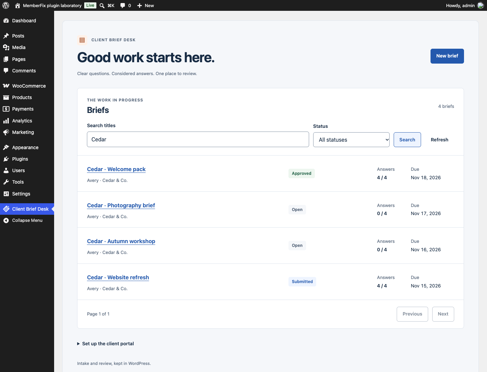
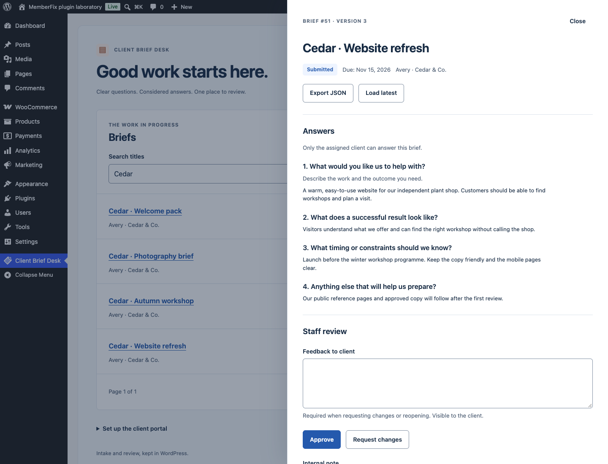

# Client Brief Desk — WordPress client intake and approvals

[Screenshots and step-by-step setup tutorial](https://memberfix.studio/plugins/client-brief-desk/)

**Get the details right before the work begins.**

A free, open-source WordPress client intake plugin for service businesses. Collect project details in a private client portal, turn a long email into a clear checklist, let clients save their progress, request revisions, and approve the exact answers you reviewed.



[Download the installable plugin](https://github.com/memberfixstudio-ind/client-brief-desk/releases/latest) · [Research](docs/RESEARCH.md) · [Validation](docs/VALIDATION.md) · [Changelog](CHANGELOG.md)

## A complete brief, from request to approval

1. **Start with useful questions.** Choose a service project, website or event preset, then edit the questions before creating the brief. Assign an existing WordPress client account and an optional due date.
2. **Let the client work at their own pace.** The client portal shows only their briefs, required-answer progress and clear save/submit controls. Incomplete drafts can be saved.
3. **Review one version.** Request changes with specific feedback, or approve a submitted brief. Submitted and approved answers remain read-only until explicitly reopened.
4. **Keep the context.** An activity history records submissions and decisions, including answer snapshots. Internal notes stay visible only to administrators. Export the saved brief as JSON.



Screenshots show fictional demo records on a disposable WordPress site.

Examples: a photographer collecting a shoot brief, a studio gathering website copy, a consultant clarifying a service request, or an event team collecting practical details.

This is an open-source alternative in an established category. It makes no claim to be the first client portal or to replace a full CRM.

## Install and use

Requires **WordPress 6.8+, PHP 8.2+, and InnoDB database tables**.

1. Upload **client-brief-desk.zip** through Plugins → Add New → Upload Plugin, then activate it.
2. Add `[client_brief_desk]` to a WordPress page and publish it. A Shortcode block works in Gutenberg.
3. Use an existing WordPress account for each client. A Subscriber account is sufficient; create accounts through WordPress's normal Users screen if needed.
4. Open **Client Brief Desk** in wp-admin. Create a brief and assign the client.
5. Share the portal page through your usual communication channel. The plugin sends no invitations or reminders.

No SaaS account, license key, external service, build step or paid dependency is required. All shipped features are GPL-2.0-or-later.

## What makes the workflow dependable

- **Account isolation:** list, detail, write and export requests check the signed-in account. Changing an ID in a URL does not grant access to another client's work.
- **Explicit staff permissions:** only administrators (`manage_options`) create and review briefs. Staff cannot write answers on a client's behalf.
- **Version checks:** stale saves, submissions, reviews and deletions return a conflict. The interface preserves typed content so it can be compared with the latest saved version.
- **Transactional history:** an update and its activity entry commit together. A failed history write rolls back the update.
- **Preserved submissions:** each submitted/approved snapshot stores the questions and answers reviewed. An explicit reopen starts another review cycle; prior decisions remain in history.
- **Private notes:** staff notes are excluded from client detail, history and JSON export.

## Deliberate limits

- Text answers only: no file uploads, payments, automatic emails or publishing into website pages. Use public reference URLs without embedding credentials.
- A brief's client and question structure are fixed after creation. Duplicate reuses the original questions for the same client. Create a new brief for a different client or question structure.
- Approval records staff review of a brief; it is not an electronic signature service.
- The interface/export includes the most recent 50 activity entries. JSON includes `history.limit`, `history.returned` and `history.has_more` so truncated history is explicit. WordPress's personal-data exporter includes retained client-facing history in paginated batches. Database administrators can edit database records; the activity history is not tamper-proof evidence.
- Due dates are calendar dates in the WordPress site timezone. They do not trigger reminders or reject submissions.
- Exclude logged-in portal pages and the plugin's REST routes from shared page/CDN caches. Responses use private/no-store headers, but an overriding proxy configuration must respect them.
- This release is validated for single-site WordPress. Multisite/network activation has not been validated.

## Common questions

### How do I collect a client brief in WordPress?

Add `[client_brief_desk]` to a page, then create a brief in wp-admin and assign an existing WordPress client account. Start from a service, website or event preset and edit the questions before creating the brief. The client signs in, saves answers as a draft and submits when ready. See [install and use](#install-and-use).

### Can clients see each other's briefs or internal notes?

Clients can access only briefs assigned to their account. Staff notes are excluded from client responses and exports on the server. Administrators with `manage_options` can create and review briefs. Keep signed-in portal pages out of shared caches, as described in [the limits](#deliberate-limits).

### Can I request changes after a client submits their answers?

Yes. Staff can request changes with feedback, which reopens the brief for the client. Submitted answers are otherwise read-only. Approvals refer to a specific submission; reopening an approved brief starts a new review cycle while preserving earlier decisions and snapshots in its history.

### Is this a form builder or a full client CRM?

It is a focused text-brief and approval workflow for existing WordPress accounts. It does not include file uploads, payments, automatic invitations or reminder emails. There is no paid tier, SaaS account or license key; all shipped features are GPL-2.0-or-later.

## Data ownership and maintenance

Data stays in two plugin-owned database tables. No telemetry or remote requests are made. Site administrators should set a retention practice suitable for the work they collect; there is no automatic purge of active briefs.

Archive old work, then explicitly delete it when no longer needed. Deletion removes the brief and its associated snapshots. WordPress **Tools → Export Personal Data / Erase Personal Data** includes assigned client briefs. Erase client briefs before deleting the client account. If an account has already been deleted and orphaned briefs exist, privacy tools flag manual review: administrators must identify, archive and delete those records. The plugin does not retain a separate email-to-account mapping. Uninstall preserves data unless `define('CBD_DELETE_DATA', true);` is set in wp-config.php before deletion. Back up records before deleting them.

## For developers

PHP, WordPress REST authentication, InnoDB transactions, scoped native JavaScript and CSS. No framework or production package dependency.

- [Runtime/API contract](docs/CONTRACT.md)
- [Real WordPress integration tests](tests/integration.php)
- [Security policy](SECURITY.md)
- [Research and competing options](docs/RESEARCH.md)

Run tests only on a disposable installation with `MFS_TESTS=true`:

```sh
wp eval-file /path/to/client-brief-desk/tests/integration.php
```

Built by [Rohan Salave](https://www.linkedin.com/in/rohan-salave-362475189/) at [MemberFix Studio](https://memberfix.studio/) · [More WordPress work](https://github.com/memberfixstudio-ind).
